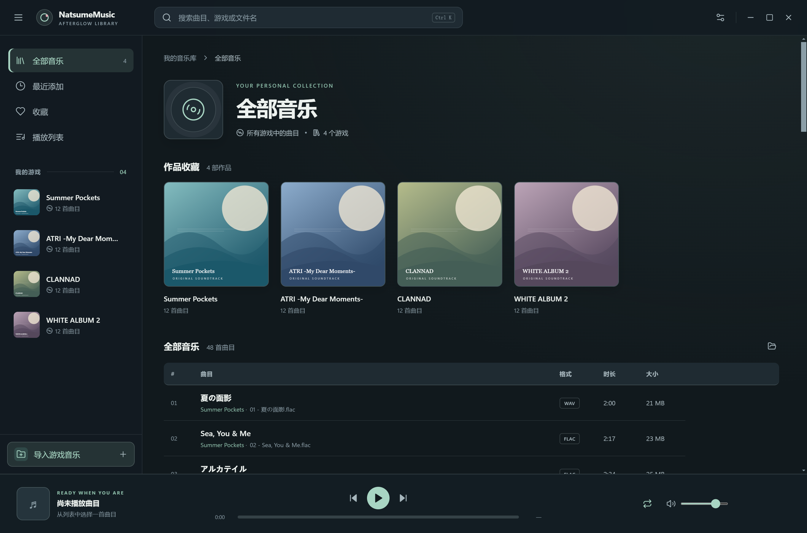
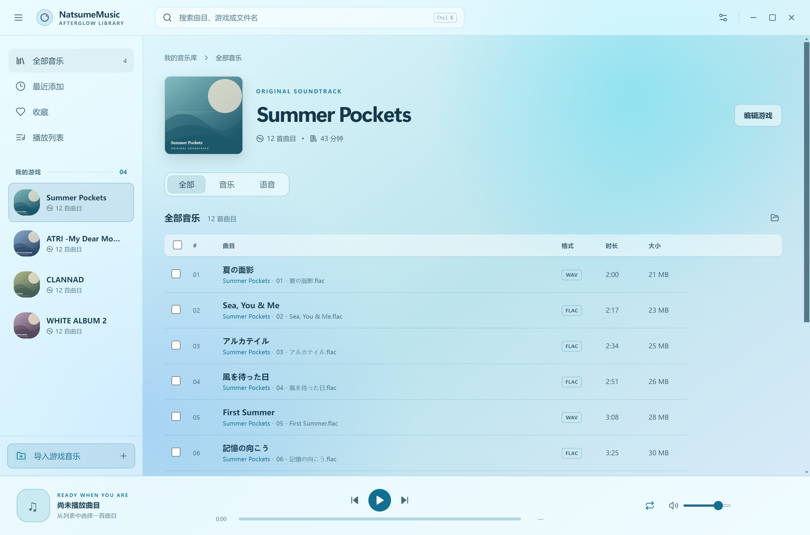
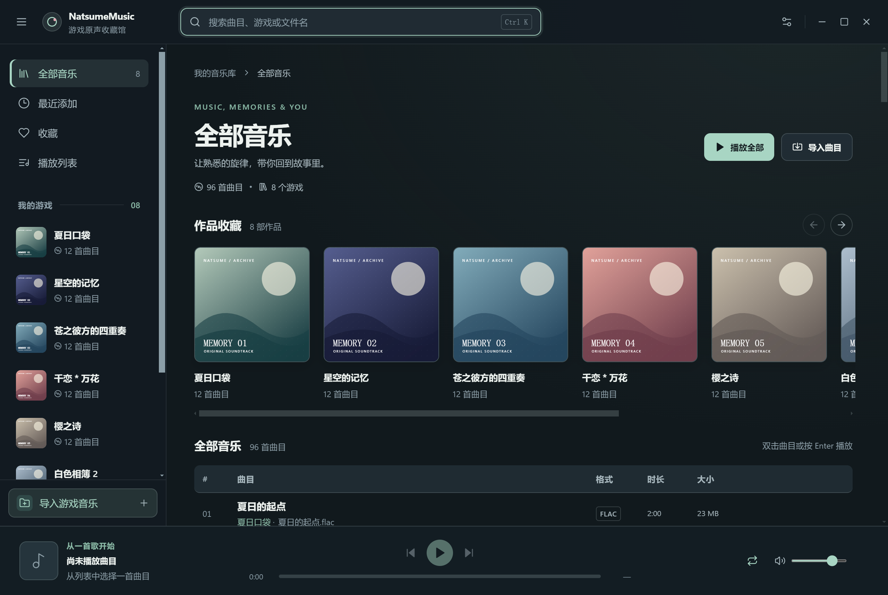
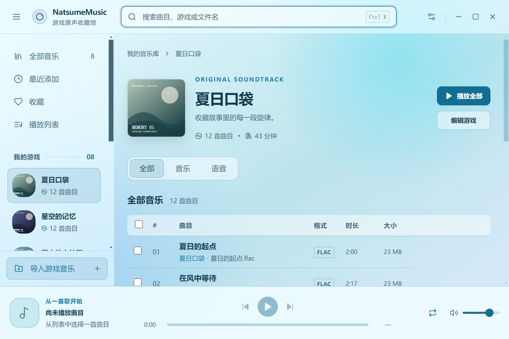
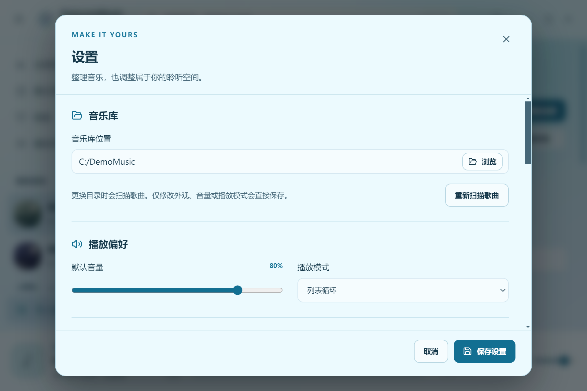

# NatsumeMusic 前端外观与交互

2026-10-14 完成一轮音乐资料库界面改造，参考 [UI/UX Pro Max](https://github.com/nextlevelbuilder/ui-ux-pro-max-skill) 的设计搜索与交互建议。技能源码克隆到项目的同级目录 `../ui-ux-pro-max-skill`，设计搜索用于参考，不作为应用运行依赖。

## 外观

- 默认主题使用深灰蓝与柔和绿色，减少反光和强阴影；表头移除 SVG 折射，曲目行不使用模糊滤镜。
- 全部音乐首页展示作品封面，可横向滚动并点击进入作品。无封面时显示唱片占位图。
- 作品页展示封面、名称、曲目数与总时长；播放器展示当前歌曲所属作品的封面。
- 保留七套主题、自定义背景与文字颜色。设置和资料选择弹窗使用实体主题底色，保持文字清晰。

## 动效与布局约定

- 共享时长：按钮反馈 `120–140ms`，弹窗进入 `220ms`，遮罩淡入 `160ms`。
- 页面导航使用 Anime.js 4.4：旧视图用 `70ms` 淡出并上移 `4px`，新视图用 `190ms` 淡入并从下方 `6px` 回到原位，总计约 `260ms`。只保留一个可交互的真实视图，退出阶段暂时禁止旧内容交互，避免点击到即将离开的曲目。
- 连续点击取消旧动画与待执行导航，以最后一次选择为准；点击当前页面取消尚未完成的切换。提交导航使用独立短计时，不依赖动画完成回调，动画结束或取消后清理样式。
- 页面切换仅动画整个内容视图；虚拟列表不逐行动画。搜索、排序和曲目分类筛选不重新播放页面进入动画。
- 侧栏和曲目分类使用滑动选中底色，按实际按钮尺寸定位并响应窗口大小变化。封面悬浮略微抬升，按钮与批量操作按下略微缩小，收藏图标和播放暂停图标有短暂状态反馈。
- 键盘操作取消页面、弹窗及常用按钮过渡，并保留清晰的焦点轮廓。遵循系统“减少动态效果”设置。
- 右侧主内容保持单一滚动容器，虚拟曲目行保持 `60px`；桌面最低支持 `960×640`。

主要文件：`src/renderer/src/styles/globals.css`、`App.tsx`、`hooks/useNavigationMotion.ts`、`hooks/useSelectionIndicator.ts`、`components/layout/Sidebar.tsx`、`components/library/GameShelf.tsx`、`components/layout/PlayerBar.tsx`。

## 开发与验证

在 PowerShell 中启动开发应用：

```powershell
Set-Location 'D:\Codex\galgame music app\galgame-music-app'
npm run dev
```

验证结果：前端测试 15 个文件、97 项全部通过；TypeScript 类型检查和 `npm run build` 通过。独立 Electron + Vite 演示环境使用四部作品、48 首模拟曲目，验证了封面导航、返回全部音乐、收藏、曲目选择、真实指针按压反馈、键盘导航与焦点、七套主题预览、减少动态效果、深浅色最小窗口布局，并确认无横向溢出或界面警告。该检查不使用用户音乐库。

本轮更新开发源码，没有生成 EXE，也没有修改版本号。下方预览使用演示封面和模拟曲目。

## 外观保存等待修复

修复保存主题后持续等待：此前所有设置保存都会重新扫描音乐目录，并等待前端重新加载整库。现在，目录没有变化时，外观、音量和播放模式直接写入设置，不进入音乐库扫描队列，也不重新加载作品和曲目。

更换目录仍自动扫描；同一目录新增或改名歌曲时使用「重新扫描歌曲」。该操作通过可选的 `rescanLibrary` 参数明确请求扫描，后端会验证参数类型。

验证：57 个测试文件、341 项测试全部通过，类型检查与开发构建通过。在独立 Electron + Vite 环境中使用真实保存接口及 660 首演示曲目，七套主题的保存和弹窗关闭耗时约 25–80 毫秒，逐一确认主题已持久保存，显式重新扫描后曲目数保持不变。计时是本机演示库结果。

## 导航动效验证

已接入 Anime.js 4.4；按钮按压和选中底色仍采用短时 CSS 过渡。动画与设置保存、目录扫描分开运行。键盘输入可以立即结束正在进行的指针转场；系统切换到“减少动态效果”时立即恢复静态页面。

前端 16 个测试文件、106 项测试通过，包含连续导航、返回当前页、进入中再次切换、键盘即时导航、运行中改变减少动态效果偏好和卸载清理。类型检查与开发构建通过。

独立 Electron + Vite 演示环境验证实际退出与进入动画、最后目标导航、侧栏及分类选中底色定位、真实指针反馈、键盘焦点、减少动态效果、七套主题和最小窗口布局，无界面警告或横向溢出。使用真实保存接口的独立 660 首曲目演示库，七套主题保存与弹窗关闭约 `76–216ms`，持久保存及重新扫描检查通过。该计时为本机演示库结果。

## 歌曲读取反馈与等待优化

此前页面导航和搜索输入都要等待 `120ms` 才请求曲目，导致转场后短暂显示旧歌曲，随后才进入读取状态。现在切换页面、作品、播放列表和曲目分类时立即读取，清空搜索也立即恢复列表；仅连续输入搜索关键词保留 `120ms` 防抖。

进入读取状态时先移除上一页曲目；等待超过约 `140ms` 才显示小型转圈和「正在读取曲目…」，快速读取不闪出提示。数据返回后立即显示结果，不设置额外的最短展示时间。转圈只使用一个 CSS 旋转图标，不增加请求；系统开启减少动态效果时显示静态图标和文字。

验证：前端 17 个测试文件、109 项测试通过，类型检查与开发构建通过。独立 Electron + Vite 演示环境模拟 `500ms` 慢读取，确认转圈正常出现、结果返回后消失，离开页面后旧请求返回不会覆盖当前作品，同时保留原有转场、焦点、主题和窗口布局检查。





## 2026-10-18：信息层级与日常操作优化

本轮使用本机安装的 `ui-ux-pro-max` 技能，采用适合桌面音乐库的可读性、键盘操作、可发现性与减少动态效果建议。保留现有七套主题和 Anime.js 页面转场，未新增运行依赖、修改版本号或生成安装包。

- 首页移除通用唱片占位大图，突出标题、当前曲目数量和「播放全部」。播放队列使用当前分类、作品及搜索结果，加载中或无曲目时禁用按钮。
- 调整字号、行距、留白和辅助文字颜色；曲目行保持 60px，兼容现有虚拟列表。三套浅色主题的主按钮改用白字深色底。
- 作品收藏增加左右浏览按钮，依据实际滚动位置启用；窗口尺寸改变后重新检测溢出。减少动态效果开启时直接滚动。
- 搜索支持 `Ctrl+K` 聚焦、`Esc` 清空和可见清除按钮；面包屑可返回完整音乐库并清空搜索。
- 设置按音乐库、播放偏好、软件外观分组，保存与取消固定在底部。键盘焦点停留在弹窗内，`Esc` 取消预览，关闭后返回原按钮；保存等待期间不会被 `Esc` 提前关闭。
- 未选择歌曲时禁用播放器的上一首、播放、下一首与进度拖动，避免无响应的操作。

验证：完整测试集、TypeScript 类型检查及开发构建均通过。隔离的 Electron 演示环境使用 8 部作品、96 首模拟曲目，20 项界面检查通过，覆盖七套主题切换、保存关闭、真实键盘快捷键与焦点循环、封面滚动、快速切页，以及 1280×860 和 960×640 窗口布局。未读取用户曲库。演示保存使用模拟接口，真实持久化由现有设置与目录测试覆盖。

七套主题的辅助文字与三层基础背景色、主按钮文字与强调色均检查对比度，最低值超过 4.5:1；此结果针对主题默认颜色，自定义背景和文字颜色仍由用户选择。

以下图片使用演示封面与曲目：




